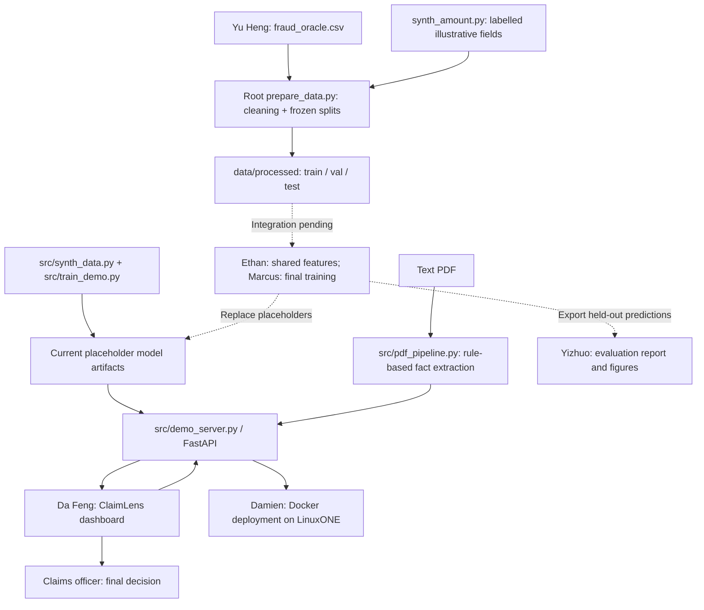

# ClaimLens architecture

Owner: Yizhuo. Source reviewed at team repository commit `e08949b`; deployment details confirmed by Damien on 17 October 2026. Status: team demo implemented; final real-data model integration pending.

## Purpose and boundary

ClaimLens supports insurance claims triage with a fraud-ranking score, a risk tier, factor sensitivity and a sentence-by-sentence PDF walkthrough. A claims officer retains the decision. Neither suspected fraud nor policy coverage is established by the score. No urgency classifier or calibrated probability has been verified.

## Current team implementation

The data and final-model arrows are explicitly pending. The current demo trainer generates its own synthetic data; it does not train on Yu Heng's processed CSVs.

## Component contracts observed in source

| Component | Current behaviour | Owner / next handoff |
| --- | --- | --- |
| Root `prepare_data.py` | Cleans historical claims, adds labelled synthetic fields and writes frozen splits stratified by label and year | Yu Heng: confirm source/licence and leakage checks |
| `src/features.py` | Absent at this reviewed commit | Ethan: shared preprocessing and real-data/API mapping |
| `src/train_demo.py` | Scaled logistic regression and XGBoost trained on synthetic demo records | Marcus: final `src/train.py`, predictions, model and preprocessing artifacts |
| `models/` | `model.json`, `lr.json`, `trees.json`, `metrics.json`; metrics identify synthetic placeholders | Marcus + Damien: agree which artifacts the final API will load |
| `src/demo_server.py` | API plus static dashboard; currently averages LR and XGBoost scores equally | Damien: preserve or deliberately change the final scoring contract |
| `src/pdf_pipeline.py` | Regex-based fact extraction from text PDFs, rescoring after each sentence | Da Feng: align extraction with final feature definitions |
| `deploy/claimlens.Dockerfile` | Ubuntu s390x libraries, API dependencies and demo training during image build | Damien: change the build path to preserve/use the final trained model |

### Scoring and explanations

`POST /score` currently uses five demo inputs: `claims_last_12m`, `days_policy_to_incident`, `vehicle_age`, `claim_amount`, `police_report`. Missing inputs fall back to stored baseline values. The score is `(p_lr + p_xgb) / 2`; tiers are `< 0.30` fast-track, `0.30–<0.60` review, `≥ 0.60` investigate. These are demo choices, not verified final operating points. **Final scoring method and tier thresholds are pending Marcus’s confirmation; Damien will align the API with the final model.**

`contributions[].impact` is the score difference when one factor is replaced by its stored baseline, holding the other current inputs fixed. This is sensitivity in score units, **not SHAP or an additive log-odds decomposition**. Effects need not sum to the score and are not causal. Exclusion replaces requested known factors with their baselines and rescoring occurs.

Endpoints also include `GET /health`, `GET /model/info`, and `POST /analyze`. PDF analysis uses `pypdf` and regular expressions; it is not an LLM or generative AI agent. Scanned image PDFs are unsupported. Policy-document verification is outside the current implementation.

## LinuxONE deployment

Damien confirms the following team server configuration:

| Component | Confirmed configuration |
| --- | --- |
| Host platform | IBM LinuxONE, s390x |
| Operating system | Ubuntu 24.04 |
| CPUs | 3 |
| RAM | 7.8 GB |
| Application stack | FastAPI service with logistic regression / XGBoost in Docker |
| Notebook environment | JupyterLab on port 38888 |
| Final scoring method | Pending Marcus's confirmation; API integration owned by Damien |

The team recipe uses a `claimlens` container bound to server loopback port 8000 and an SSH tunnel for browser access. Sources: `deploy/claimlens.compose.yml` and Damien's team update. Final real-data model deployment remains pending; the running demo is not evidence that the final model has been integrated.

Capture the actual team instance, architecture, container, final model version and successful scoring call after final integration. Record runtime/library versions and resource measurements; hardware availability alone does not establish throughput or latency.

## Final integration checks

1. Map the processed CSV schema to the API and PDF feature schema. Do not treat category bands as exact counts/days or silently substitute unavailable fields.
2. Keep `claim_id`, `FraudFound_P` and `split` out of training features. The data owner excludes `(synth)` columns from fraud-model features; final feature selection must respect that distinction.
3. Agree whether the served model is XGBoost alone or the current ensemble. Evaluate exactly the served scoring function.
4. Supply all artifacts required by that function, including LR scaling/weights, baselines, tiers and tree-display data where used. Replacing only `model.json` is insufficient for the current API.
5. Remove or replace Docker's `RUN python3 src/train_demo.py` before building the final image; otherwise it recreates placeholder artifacts.
6. Freeze thresholds on validation data before final test evaluation and the video.
