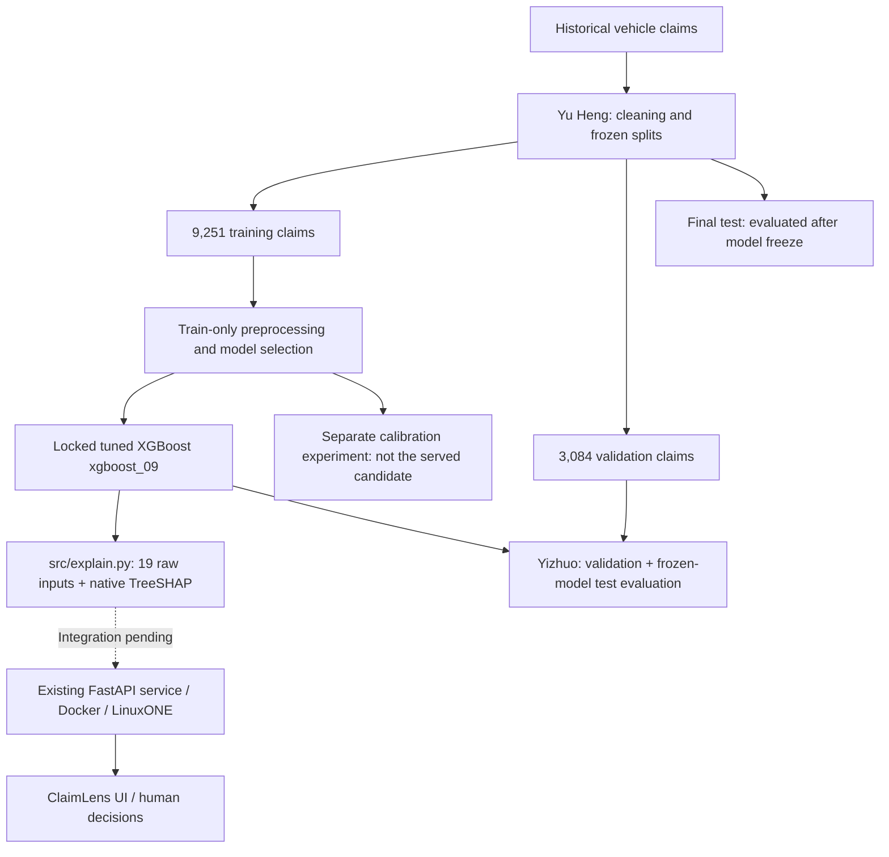

# ClaimLens architecture

Owner: Yizhuo. Updated against Marcus's model commit `48e14f9eb3aae344bb14c8f66ef05893276ad2a8` on 17 October 2026.

**Status:** the user confirmed locked tuned XGBoost as the final model and authorised the completed once-only test evaluation. Subsequent read-only server checks verified the locked scorer and model-test API on LinuxONE; full API metadata, dashboard and PDF integration remain incomplete. See `docs/figures/integration-check/README.md`. The separate probability-calibration experiment has not replaced this model.

## Purpose

Support human prioritisation of insurance claims using a relative fraud-risk score and explanations. A high score is not a fraud finding, and a low score does not clear or approve a claim. Policy coverage verification and an urgency classifier are outside the implemented model.

## Model and service pipeline

Final test predictions, metrics and figures are now saved under `docs/figures/test/` and reported in `docs/evaluation.md`. No model or threshold was tuned on test. Earlier validation metrics remain exploratory because of repeated inspection.

## Data and preprocessing

Source documentation identifies historical 1994–96 vehicle claims; label `FraudFound_P` maps 1 to fraud and 0 to non-fraud. Frozen splits are stratified by label and year with seed 42. Synthetic incident type, severity and amount fields are excluded from prediction. Dataset licence confirmation and claim-time feature provenance remain open.

The candidate uses 19 original source fields: `Deductible`, `Month`, `WeekOfMonth`, `DayOfWeek`, `MonthClaimed`, `WeekOfMonthClaimed`, `DayOfWeekClaimed`, `Make`, `AccidentArea`, `VehicleCategory`, `BasePolicy`, `AgentType`, `VehiclePrice`, `DriverRating`, `Days_Policy_Accident`, `Days_Policy_Claim`, `PastNumberOfClaims`, `AgeOfVehicle`, and `NumberOfCars`.

Its saved pipeline owns train-fitted imputation and one-hot preprocessing. Preserve original types and category bands; do not invent exact values. Ethan's separate `build_features` schema is not the candidate's input contract and must not be applied in front of this pipeline. Transform exactly once.

## Candidate artifacts and output

| Artifact | Role |
| --- | --- |
| `models/baseline.joblib` | Original balanced logistic-regression baseline |
| `models/experiments/capacity_20261017T042040511095Z/xgboost_09.joblib` | Complete locked tuned XGBoost pipeline; deployment candidate |
| `reports/explain_runtime/manifest.json` | Candidate hash, model path and provisional bands |
| `src/explain.py` | Relative score, priority band, original-feature TreeSHAP and what-if analysis |
| `models/experiments/probability_20261017T050105523504Z/` | Separate calibration experiment; not a silent replacement |
| `src/MODEL_GUIDE.md` | Model development, contracts, limitations and handoff guide |

The scorer returns `risk_score`, `tier`, `contributions`, `excluded`, plus model, data-quality and sensitivity metadata. The candidate score is uncalibrated: do not display it as a verified probability of fraud. Provisional tiers use boundaries 0.25596985 and 0.31254968 derived from validation score distributions; they do not guarantee queue capacity or safe clearance.

Native exact TreeSHAP impacts are aggregated from encoded columns back to the 19 original features in **log-odds**. The bias plus all impacts reconstructs the model margin; sigmoid of that margin reconstructs the raw score. A global feature chart uses mean absolute impacts, not feature gain or causal effects.

What-if replaces selected inputs with their fitted train-only median/modes and rescoring occurs. It does not retrain or delete feature columns. Display sensitivity separately from the observed score. Missing/unknown inputs are flagged; the API/UI must preserve those warnings and `operational_routing_allowed` metadata.

## Existing demo versus final integration

At the reviewed commit, `src/demo_server.py` still loads the older five-feature synthetic artifacts and averages demo LR/XGBoost scores 50/50. Its PDF extraction and visualisations also use that schema. This does not describe the new 19-input scorer. The demo's score-drop contributions are not the new scorer's TreeSHAP explanations.

Damien and Da Feng need to wire the new scorer and metadata, align PDF/form inputs, adapt the contribution formatter to log-odds, and ensure the final container uses the committed candidate rather than running `train_demo.py` over it. The user confirmed locked tuned XGBoost as final; the API still needs to be aligned with that decision. The calibration experiment improves probability losses but is not the current risk-ranking candidate.

## LinuxONE environment and evidence

| Component | Confirmed by Damien |
| --- | --- |
| Platform | IBM LinuxONE, s390x |
| OS | Ubuntu 24.04 |
| CPUs / RAM | 3 CPUs / 7.8 GB RAM |
| Services | FastAPI in Docker; JupyterLab on port 38888 |
| Team demo access | Loopback port 8000 via SSH tunnel |

Marcus's saved training/verification environment was Windows AMD64. The new scorer has now passed artifact loading and 20 exact API-score parity checks in the LinuxONE model-test container, with valid contribution shape/units, what-if and quality/error behaviour. Full dashboard/PDF integration remains incomplete. Do not use another prototype's deployment as evidence for this model, or quote local warm-model timings as server/API latency.

## Completion handoffs

- Marcus: keep the confirmed model and thresholds frozen; review the completed final-test report without tuning against its results.
- Damien: integrate the complete pipeline, preserve metadata and verify it on LinuxONE.
- Da Feng: align 19-input UI/extraction, contribution units and sensitivity/quality displays.
- Yizhuo: review the completed test tables/figures and use matching final-test numbers in the video; obtain the final model’s LinuxONE evidence from Damien.

## Latest integration source: `393ad1c`

After the checks above, commit `393ad1c` reached `main`. It wires `/score` to `explain.score`, introduces `/model/final` for the 19-field metadata, exposes `/demo/score` separately, and changes the Dockerfile to copy committed model artifacts instead of retraining. `/model/info` and `/analyze` remain demo interfaces by design in that commit. The served UI was not changed in that commit. The verification report describes the earlier running containers; this newer source/deployment still needs a fresh end-to-end check. These source changes do not alter the evaluated model or its test results.
