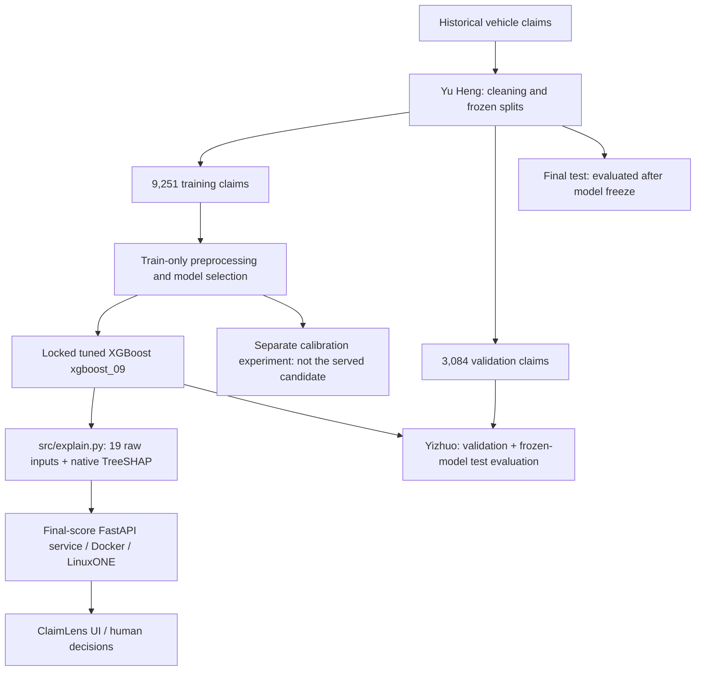

# ClaimLens architecture

Owner: Yizhuo. Updated against Marcus's model commit `48e14f9eb3aae344bb14c8f66ef05893276ad2a8` on 17 October 2026.

**Status:** xgboost_09 alone is the final model. The 19-field API/UI was deployed and verified on LinuxONE after commit 8346c73; the current numeric thresholds were rechecked after bc85518 / aa60ed7. Review begins at 0.1754, investigate at exact score 0.31254968 (displayed approximately as 0.31255). The separate calibration experiment has not replaced this model. Original frozen-test results and the subsequent routing-policy reanalysis are reported separately.

## Purpose

Support human prioritisation of insurance claims using a relative fraud-risk score and explanations. A high score is not a fraud finding, and a low score does not clear or approve a claim. Policy coverage verification and an urgency classifier are outside the implemented model.

## Model and service pipeline

Final test predictions, metrics and figures are now saved under `docs/figures/test/` and reported in `docs/evaluation.md`. The original model/test evaluation used its predeclared thresholds. The later team-supplied review-policy change is applied separately to cached scores and labelled as post-evaluation routing analysis. Earlier validation metrics remain exploratory because of repeated inspection.

## Data and preprocessing

Source documentation identifies historical 1994–96 vehicle claims; label `FraudFound_P` maps 1 to fraud and 0 to non-fraud. Frozen splits are stratified by label and year with seed 42. Synthetic incident type, severity and amount fields are excluded from prediction. Dataset licence confirmation and claim-time feature provenance remain open.

The candidate uses 19 original source fields: `Deductible`, `Month`, `WeekOfMonth`, `DayOfWeek`, `MonthClaimed`, `WeekOfMonthClaimed`, `DayOfWeekClaimed`, `Make`, `AccidentArea`, `VehicleCategory`, `BasePolicy`, `AgentType`, `VehiclePrice`, `DriverRating`, `Days_Policy_Accident`, `Days_Policy_Claim`, `PastNumberOfClaims`, `AgeOfVehicle`, and `NumberOfCars`.

Its saved pipeline owns train-fitted imputation and one-hot preprocessing. Preserve original types and category bands; do not invent exact values. Ethan's separate `build_features` schema is not the candidate's input contract and must not be applied in front of this pipeline. Transform exactly once.

## Candidate artifacts and output

| Artifact | Role |
| --- | --- |
| `models/baseline.joblib` | Original balanced logistic-regression baseline |
| `models/experiments/capacity_20261017T042040511095Z/xgboost_09.joblib` | Complete locked tuned XGBoost pipeline; deployment candidate |
| `reports/explain_runtime/manifest.json` | Candidate hash, model path and provisional bands |
| `src/explain.py` | Relative score, priority band, original-feature TreeSHAP and what-if analysis |
| `models/experiments/probability_20261017T050105523504Z/` | Separate calibration experiment; not a silent replacement |
| `src/MODEL_GUIDE.md` | Model development, contracts, limitations and handoff guide |

The scorer returns `risk_score`, `tier`, `contributions`, `excluded`, plus model, data-quality and sensitivity metadata. The candidate score is uncalibrated: do not display it as a verified probability of fraud. Current live tiers are fast-track below **0.1754**, review from **0.1754** to below **0.31254968**, and investigate at or above **0.31254968** (displayed approximately as **0.31255**). The review boundary was replaced in bc85518 using Yu Heng’s validation-based risk-layer cutoff; the investigation boundary is unchanged. On validation, review-only workload is now 53.99%, investigation 9.99%, and total human-review workload 63.98%. These are observed workload shares, not future queue guarantees or permission to clear claims.

Native exact TreeSHAP impacts are aggregated from encoded columns back to the 19 original features in **log-odds**. The bias plus all impacts reconstructs the model margin; sigmoid of that margin reconstructs the raw score. A global feature chart uses mean absolute impacts, not feature gain or causal effects.

What-if replaces selected inputs with their fitted train-only median/modes and rescoring occurs. It does not retrain or delete feature columns. Display sensitivity separately from the observed score. Missing/unknown inputs are flagged; the API/UI must preserve those warnings and `operational_routing_allowed` metadata.

## Serving interfaces and demo separation

The live `POST /score` endpoint calls the final 19-input XGBoost scorer, with `GET /model/final` providing fields, allowed category values, labels and thresholds. The claim form displays an uncalibrated ranking score and native log-odds contributions, supports real low/medium/high examples, driver navigation and a hypothetical what-if/reset flow.

The PDF walkthrough remains a separate five-input synthetic-model demonstration: `/analyze`, `/demo/score` and `/model/info` serve that mode. Its ensemble behaviour and demo metrics do not describe the final model. The Docker build copies committed model artifacts and no longer trains a demo model over them. UI source and API checks matched release 8346c73; aa60ed7 subsequently changed the band text to show numerical cutoffs.

## LinuxONE environment and evidence

| Component | Confirmed by Damien |
| --- | --- |
| Platform | IBM LinuxONE, s390x |
| OS | Ubuntu 24.04 |
| CPUs / RAM | 3 CPUs / 7.8 GB RAM |
| Services | FastAPI in Docker; JupyterLab on port 38888 |
| Team demo access | Loopback port 8000 via SSH tunnel |

Marcus's training/verification environment was Windows AMD64; offline evaluation in this chat was on macOS ARM64. On LinuxONE, the deployed artifact hash matched the locked model, 20/20 cached API scores matched exactly, and metadata, what-if, quality/error handling and browser flows passed. The later review-boundary update was verified through live API metadata. These checks are not a load benchmark or guarantee; local timings must not be called server throughput evidence.

## Completion handoffs

- Marcus: retain the frozen xgboost_09 model; align stale manifest bands/status descriptions with the current 0.1754 review boundary. Do not tune model parameters against the evaluated test results.
- Damien: retain model/version parity and collect final-system evidence matching the current thresholds.
- Da Feng: keep the 19-input final-model form and separate PDF demo clearly distinguished; retain correct contribution units and sensitivity/quality displays.
- Yizhuo: review the completed test tables/figures and use matching final-test numbers in the video; obtain the final model’s LinuxONE evidence from Damien.

## Historical source transition: `393ad1c`

After the checks above, commit `393ad1c` reached `main`. It wires `/score` to `explain.score`, introduces `/model/final` for the 19-field metadata, exposes `/demo/score` separately, and changes the Dockerfile to copy committed model artifacts instead of retraining. `/model/info` and `/analyze` remain demo interfaces by design in that commit. The served UI was not changed in that commit. The verification report describes the earlier running containers; that historical check was superseded by the successful release-8346c73 verification described above. These source changes do not alter the evaluated model or its test results.

## Current routing update: bc85518 / aa60ed7

The API and UI now use the 0.1754 review boundary, with XGBoost alone. The older “next 20% medium” text in reports/explain_runtime/manifest.json is stale metadata for Marcus to update; the numeric values define current serving. Current validation trade-off: fast-tracked fraud labels fall from 77/184 to 9/184, while review-only workload rises from 20.01% to 53.99%. Updated tables and plots are in docs/evaluation.md and docs/figures/routing-update/. The original frozen test protocol remains unchanged, and revised test-routing figures are labelled post-evaluation reanalysis.
