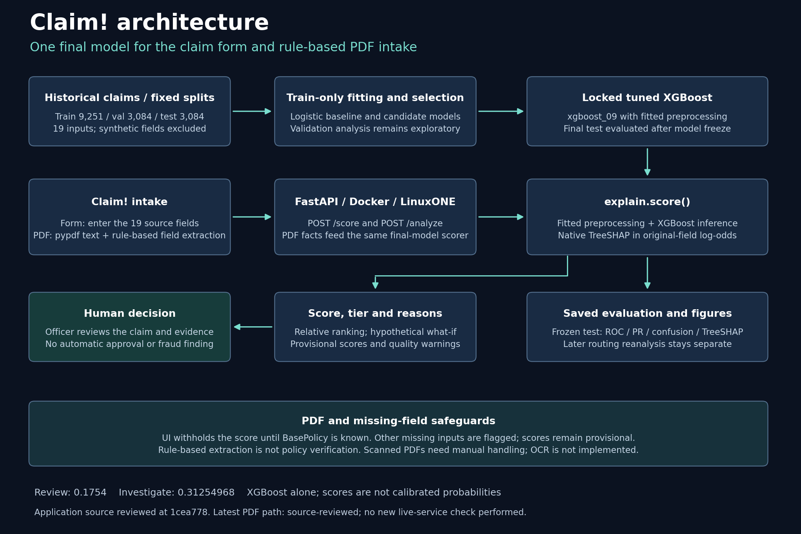
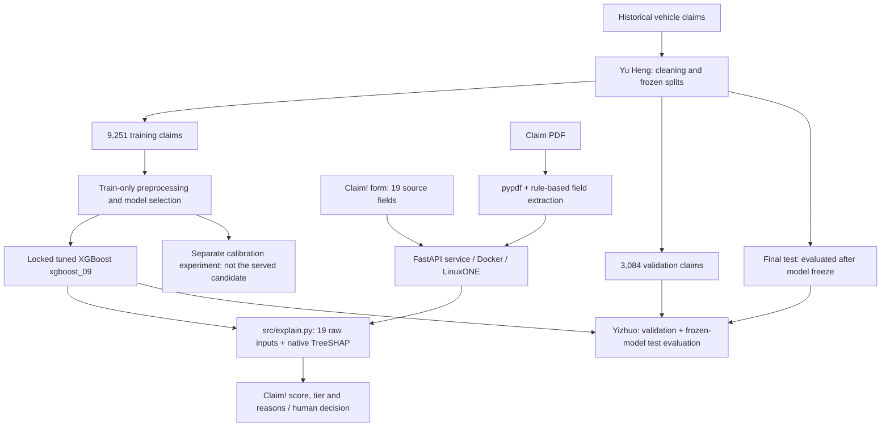

# Claim! architecture

Owner: Yizhuo. Model source: `48e14f9eb3aae344bb14c8f66ef05893276ad2a8`. Application source reviewed: `1cea778`. Updated 17 October 2026.

**Status:** xgboost_09 alone is the final model. The current source connects both the claim form and rule-based PDF reader to this model. Review begins at 0.1754, investigate at exact score 0.31254968 (displayed approximately as 0.31255). Historical LinuxONE verification covered the final claim form/API and updated thresholds; it does not certify every later PDF-reader change. The latest PDF path was source-reviewed, with no new live-service check performed for this documentation update. Original frozen-test results and subsequent routing-policy reanalysis remain separate.

## Purpose

Support human prioritisation of insurance claims using a relative fraud-risk score and explanations. A high score is not a fraud finding, and a low score does not clear or approve a claim. Policy coverage verification and an urgency classifier are outside the implemented model.

## Model and service pipeline

Final test predictions, metrics and figures are saved under `docs/figures/test/` and reported in [the evaluation](evaluation.md). The original model/test evaluation used its predeclared thresholds. The later team-supplied review-policy change is applied separately to cached scores and labelled as post-evaluation routing analysis. Earlier validation metrics remain exploratory because of repeated inspection. The PNG and editable SVG flowcharts can be regenerated with `python docs/render_flowchart.py`; the structured diagram above remains editable as Mermaid.

## Data and preprocessing

Source documentation identifies historical 1994–96 vehicle claims; label `FraudFound_P` maps 1 to fraud and 0 to non-fraud. Frozen splits are stratified by label and year with seed 42. Synthetic incident type, severity and amount fields are excluded from prediction. The team's [dataset record](../README.md#6-datasets) lists the Kaggle source licence as CC0: Public Domain. Availability of all features at claim intake remains a deployment limitation.

The candidate uses 19 original source fields: `Deductible`, `Month`, `WeekOfMonth`, `DayOfWeek`, `MonthClaimed`, `WeekOfMonthClaimed`, `DayOfWeekClaimed`, `Make`, `AccidentArea`, `VehicleCategory`, `BasePolicy`, `AgentType`, `VehiclePrice`, `DriverRating`, `Days_Policy_Accident`, `Days_Policy_Claim`, `PastNumberOfClaims`, `AgeOfVehicle`, and `NumberOfCars`.

Its saved pipeline owns train-fitted imputation and one-hot preprocessing. Preserve original types and category bands; do not invent exact values. Ethan's separate `build_features` schema is not the candidate's input contract and must not be applied in front of this pipeline. Transform exactly once.

## Candidate artifacts and output

| Artifact | Role |
| --- | --- |
| `models/baseline.joblib` | Original balanced logistic-regression baseline |
| `models/experiments/capacity_20261017T042040511095Z/xgboost_09.joblib` | Complete locked tuned XGBoost pipeline; deployment candidate |
| `reports/explain_runtime/manifest.json` | Final model hash, model path and current numerical bands |
| `src/explain.py` | Relative score, priority band, original-feature TreeSHAP and what-if analysis |
| `models/experiments/probability_20261017T050105523504Z/` | Separate calibration experiment; not a silent replacement |
| `src/MODEL_GUIDE.md` | Model development, contracts, limitations and handoff guide |

The scorer returns `risk_score`, `tier`, `contributions`, `excluded`, plus model, data-quality and sensitivity metadata. The candidate score is uncalibrated: do not display it as a verified probability of fraud. Current live tiers are fast-track below **0.1754**, review from **0.1754** to below **0.31254968**, and investigate at or above **0.31254968** (displayed approximately as **0.31255**). The review boundary was replaced in bc85518 using Yu Heng’s validation-based risk-layer cutoff; the investigation boundary is unchanged. On validation, review-only workload is now 53.99%, investigation 9.99%, and total human-review workload 63.98%. These are observed workload shares, not future queue guarantees or permission to clear claims.

Native exact TreeSHAP impacts are aggregated from encoded columns back to the 19 original features in **log-odds**. The bias plus all impacts reconstructs the model margin; sigmoid of that margin reconstructs the raw score. A global feature chart uses mean absolute impacts, not feature gain or causal effects.

What-if replaces selected inputs with their fitted train-only median/modes and rescoring occurs. It does not retrain or delete feature columns. Display sensitivity separately from the observed score. Missing/unknown inputs are flagged; the API/UI must preserve those warnings and `operational_routing_allowed` metadata.

## Claim form and PDF intake

The live `POST /score` endpoint calls the final 19-input XGBoost scorer, with `GET /model/final` providing fields, allowed category values, labels and thresholds. The claim form displays an uncalibrated ranking score and native log-odds contributions, supports real low/medium/high examples, driver navigation and a hypothetical what-if/reset flow.

The current `POST /analyze` route uses `src/pdf_pipeline.py`: pypdf extracts text, rule-based patterns map facts and dates to the model's 19 fields, and `explain.score()` re-scores the partially populated claim after sentences that add facts. The form and PDF screens therefore use the same final XGBoost model. This is field extraction from claim text, not policy-document verification or an LLM agent.

Both screens withhold the displayed score until `BasePolicy` (policy coverage category) is provided. Remaining missing fields are flagged and scores are provisional; fitted training median/modes supply missing model inputs. `/score/range` explores allowed values of missing fields to show possible score/tier changes. Empty, unreadable or scanned-image PDFs require manual handling; OCR is not implemented. Extracted values, date conventions and mappings need officer review. See [the UI handoff](claimlens.md) and [missing-field analysis](missing_fields.md).

The legacy `/demo/score` and `/model/info` endpoints still expose the earlier five-field synthetic demo artifacts; they are not the current PDF scorer or evidence for final-model metrics. The Docker build copies committed model artifacts and does not retrain them.

## LinuxONE environment and evidence

| Component | Confirmed by Damien |
| --- | --- |
| Platform | IBM LinuxONE, s390x |
| OS | Ubuntu 24.04 |
| CPUs / RAM | 3 CPUs / 7.8 GB RAM |
| Services | FastAPI in Docker; JupyterLab on port 38888 |
| Team demo access | Loopback port 8000 via SSH tunnel |

Marcus's training/verification environment was Windows AMD64; offline evaluation ran on macOS ARM64. Historical LinuxONE checks found that the deployed artifact hash matched the locked model, 20/20 cached API scores matched exactly, and metadata, what-if, quality/error handling and browser flows passed. The later review-boundary update was verified through live API metadata. These checks are not a load benchmark or guarantee; local timings must not be called server throughput evidence.

Team-provided evidence includes the [instance dashboard](evidence/01-instance-dashboard.png), [container health](evidence/02-system-containers-health.png), [CPU and memory](evidence/03-cpu-memory.png), [API request](evidence/04-api-call.png), [claim form](evidence/05a-ui-claim-form.png), [PDF walkthrough](evidence/05b-ui-pdf-walkthrough.png) and [low-priority PDF example](evidence/05c-ui-pdf-safe.png). These are screenshots of their captured release, not an automated check of subsequent deployments. The [14:09 SGT integration report](figures/integration-check/README.md) records older failures and is retained as historical evidence.

For source reviewed at `1cea778`, the final-model PDF route and required-field display guards were inspected. A fresh live upload/parity check was not performed. Damien should match the deployed revision to the final screenshots before submission; rule-based extraction accuracy on arbitrary PDFs has not been established by the model's held-out CSV metrics.

## Completion handoffs

- Marcus: the manifest now describes the current 0.1754 / 0.31254968 boundaries. Retain the frozen model and numerical thresholds; do not tune against the evaluated test results.
- Damien: confirm that final screenshots match the deployed source and retain final-model parity evidence.
- Da Feng: preserve the shared final-model path, missing-coverage guard, provisional labels and contribution units across both intake screens.
- Yizhuo: hand over the evaluation, updated flowchart and recording script; retain the original test records unchanged.

## Historical source transition: `393ad1c`

After the checks above, commit `393ad1c` reached `main`. It wires `/score` to `explain.score`, introduces `/model/final` for the 19-field metadata, exposes `/demo/score` separately, and changes the Dockerfile to copy committed model artifacts instead of retraining. `/model/info` and `/analyze` remain demo interfaces by design in that commit. The served UI was not changed in that commit. The verification report describes the earlier running containers; that historical check was superseded by the successful release-8346c73 verification described above. These source changes do not alter the evaluated model or its test results.

## Current routing update: bc85518 / aa60ed7

The API/UI source and current manifest use the 0.1754 review boundary, with XGBoost alone. Marcus has replaced the former fixed-workload wording: future workload shares are not guaranteed. Current validation trade-off: fast-tracked fraud labels fall from 77/184 to 9/184, while review-only workload rises from 20.01% to 53.99%. Updated tables and plots are in `docs/evaluation.md` and `docs/figures/routing-update/`. The original frozen test protocol remains unchanged, and revised test-routing figures are labelled post-evaluation reanalysis.
