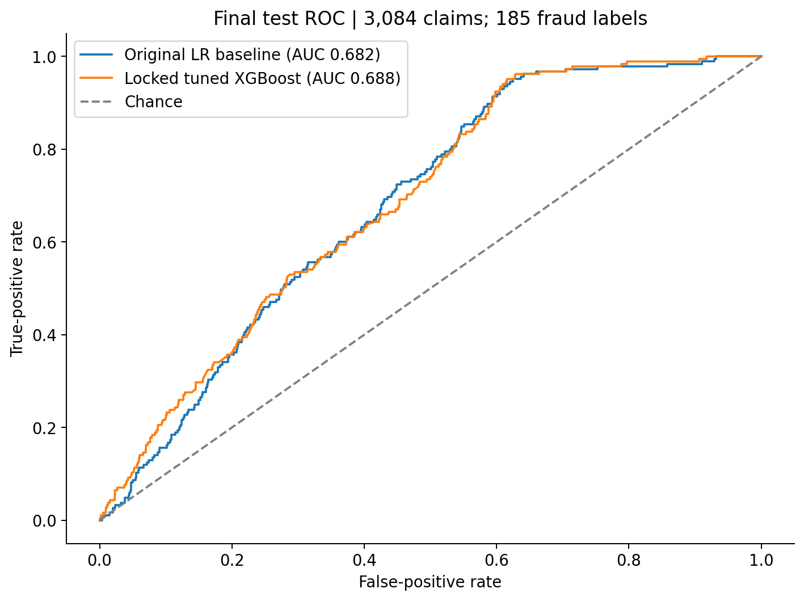
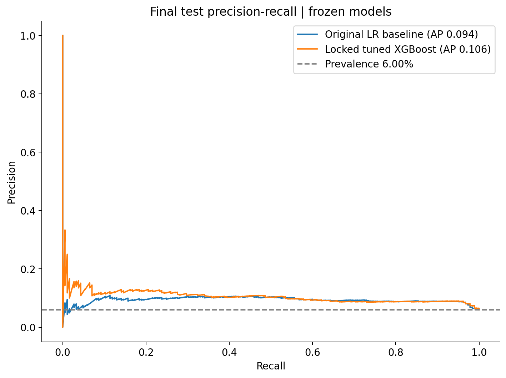
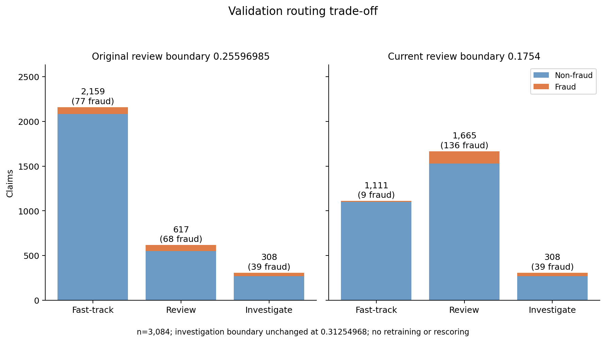
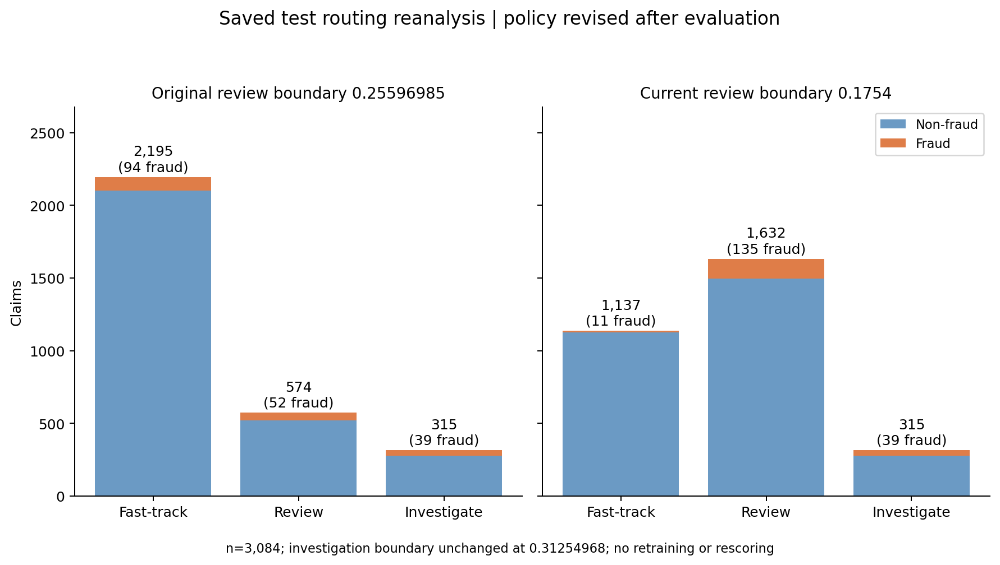
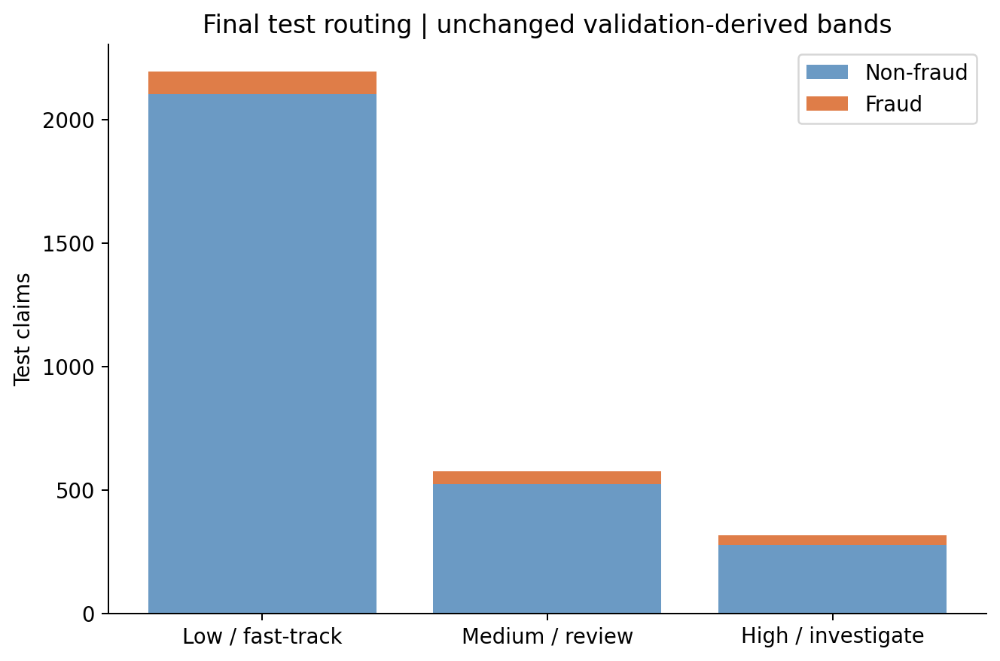
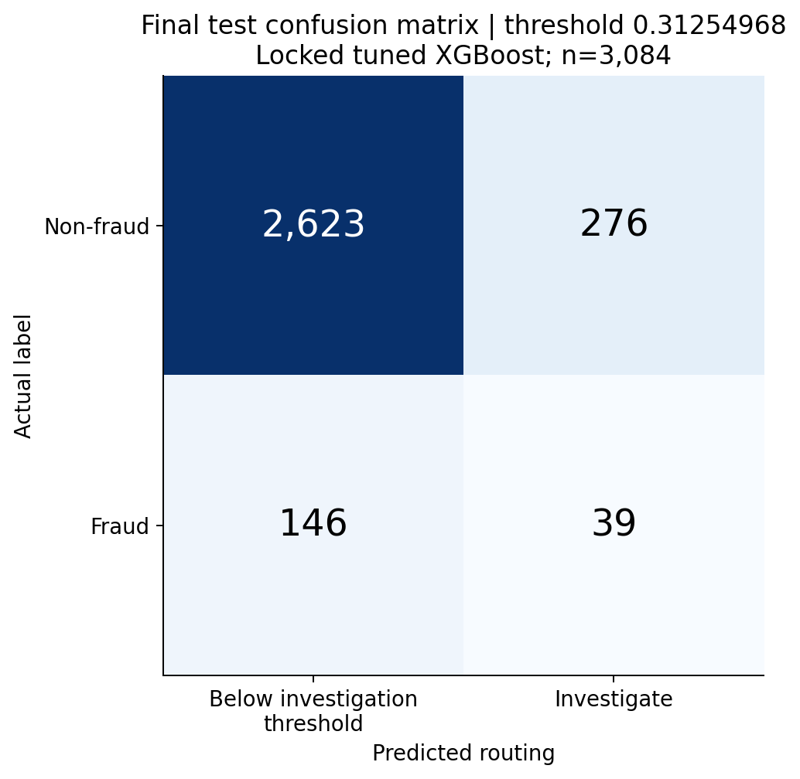
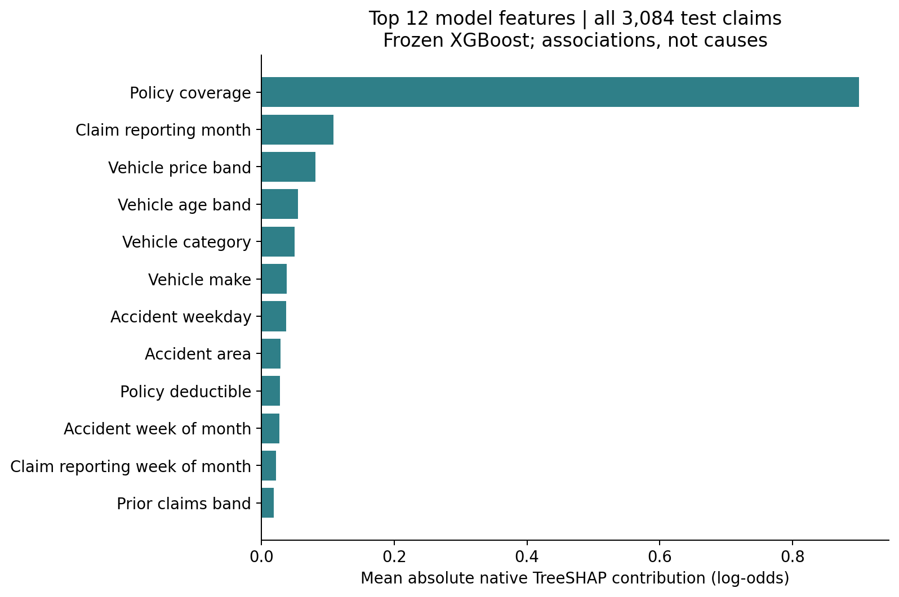

# ClaimLens final model evaluation

Owner: Yizhuo. Source model commit: `48e14f9eb3aae344bb14c8f66ef05893276ad2a8`. Evaluation date: 17 October 2026.

**Status: the user confirmed locked tuned XGBoost as final and authorised this once-only test evaluation.** The model and original score bands were frozen before opening the test data; the later live review-boundary replacement is documented separately below. The original evaluation performed no training, tuning, calibration selection, model replacement or deployment. The current update only reapplies a team-supplied routing policy to cached scores. The final model has passed LinuxONE score-parity and UI checks in this chat; the latest live metadata confirms the revised numerical boundaries. The [earlier integration report](figures/integration-check/README.md) is a historical snapshot, not the current deployment status.

## Final findings

On **3,084 test claims with 185 fraud labels (6.00%)**, the frozen XGBoost model achieves **ROC-AUC 0.6877** versus **0.6822** for the original logistic baseline. At the same 20% review capacity, XGBoost captures **65/185 fraud labels (35.14% recall)**, versus **63/185 (34.05%)** for the baseline: two additional claims, or 1.08 percentage points of recall.

This test gain is modest and smaller than the exploratory validation gain. It does not establish statistical significance or operational savings. At the unchanged investigation threshold, precision is **12.38%** and recall **21.08%**. Standard human checks remain necessary; low priority is not clearance.

## Data and frozen evaluation protocol

| Split | Claims | Fraud labels | Use |
| --- | ---: | ---: | --- |
| Training | 9,251 | 554 | Fit preprocessing/models and training-only model selection |
| Validation | 3,084 | 184 | Repeated exploratory model analysis and provisional score-band definition |
| Final test | 3,084 | 185 | Once-only evaluation after final-model confirmation |

The source documentation describes historical 1994–96 vehicle claims. `FraudFound_P = 1` denotes fraud. The existing split is stratified by label and year with seed 42; it is not a future-year holdout or proof of policyholder independence. Licence and claim-time feature provenance still need confirmation.

The final model is the complete fitted 19-input pipeline at `models/experiments/capacity_20261017T042040511095Z/xgboost_09.joblib`, not the first real-data XGBoost model, synthetic demo model, or calibrated experiment. The original comparator is `models/baseline.joblib`. Synthetic amount, incident and severity fields are excluded from prediction. Label, IDs, split indicators, explicit demographics and several fields with unresolved claim-time availability are excluded by Marcus's feature definition.

Before opening test labels, the evaluation recorded the model hashes, these existing thresholds and the previously used 10/20/30% workload comparisons in [the frozen protocol](figures/test/frozen_protocol.json). Those original thresholds were unchanged during that evaluation. The subsequent API review-boundary replacement was made after the test report and is separated from the original protocol below. Test IDs are unique and disjoint from training/validation IDs.

## Final test model comparison

| Model | ROC-AUC | Average precision (AP) |
| --- | ---: | ---: |
| Original balanced logistic baseline | 0.6822 | 0.0943 |
| Frozen tuned XGBoost | 0.6877 | 0.1061 |

AP uses the same test prevalence of 6.00%; it is not trapezoidal PR-AUC. Only the frozen XGBoost and original comparator were evaluated on test. Other experiment candidates and calibration variants were not compared on test.

*Figure 1. ROC on the same 3,084 test records using frozen continuous scores. The diagonal is chance performance.*

*Figure 2. Test precision–recall curves, with AP in the legend and a prevalence reference. Scores are relative fraud rankings, not verified individual fraud probabilities.*

## Final test at matched review workload

Rank by score descending with claim-ID ascending to resolve ties. Workloads were declared before test access. This is exact batch top-K ranking, not application of fixed score bands.

| Model | Target workload | Claims reviewed | Fraud captured | Precision | Recall |
| --- | ---: | ---: | ---: | ---: | ---: |
| Original LR baseline | 10.00% | 308 | 29/185 | 9.42% | 15.68% |
| Original LR baseline | 20.00% | 617 | 63/185 | 10.21% | 34.05% |
| Original LR baseline | 30.00% | 925 | 94/185 | 10.16% | 50.81% |
| Locked tuned XGBoost | 10.00% | 308 | 38/185 | 12.34% | 20.54% |
| Locked tuned XGBoost | 20.00% | 617 | 65/185 | 10.53% | 35.14% |
| Locked tuned XGBoost | 30.00% | 925 | 98/185 | 10.59% | 52.97% |

At 20% capacity, approximate Wilson 95% intervals for recall are 28.62%–42.25% for XGBoost and 27.61%–41.15% for the original baseline. These are separate binomial intervals, not a paired significance test. They assume independent sampled claims and do not resolve entity leakage, dataset shift or uncertainty from model selection. No claim of a statistically significant improvement is made.

## Current live routing policy: review threshold 0.1754

The team replaced the earlier confirmed review boundary of 0.25596985 with **0.1754** in commit `bc85518`, using Yu Heng's validation-based risk-layer cutoff. The final model is still **xgboost_09 alone, with no ensemble**. The investigation boundary is unchanged at the executable value **0.31254968**, commonly displayed as **0.31255**. The live `/model/final` endpoint was checked and returns these numeric values.

| Current tier | Rule |
| --- | --- |
| `fast_track` | score < 0.1754 |
| `review` | 0.1754 ≤ score < 0.31254968 |
| `investigate` | score ≥ 0.31254968 |

Use 0.1754 / approximately 0.31255 in the video. Numerical calculations use the exact API value, not a newly rounded boundary. Ranking metrics and matched top-K comparisons above are unaffected because model scores did not change.

### Validation trade-off

Both policies are applied to the same 3,084 saved validation scores and 184 fraud labels. The new cutoff was supplied by the team; this documentation update performs no threshold search.

| Measure | Original review boundary | Current review boundary |
| --- | ---: | ---: |
| Review cutoff | 0.25596985 | 0.17540000 |
| Fast-track claims | 2,159 | 1,111 |
| Fast-track share | 70.01% | 36.02% |
| Fraud labels fast-tracked | 77/184 | 9/184 |
| Fraction of all fraud labels fast-tracked | 41.85% | 4.89% |
| Review-only claims / share | 617 / 20.01% | 1,665 / 53.99% |
| Investigate claims / share | 308 / 9.99% | 308 / 9.99% |
| Total human-review workload | 29.99% | 63.98% |
| Recall across review + investigate | 58.15% | 95.11% |

Thus the review-only queue increases from **20.01% to 53.99%**, while investigation stays at **9.99%** on validation. **Combined review plus investigation rises from 29.99% to 63.98%**; do not confuse the review-only share with the total human workload. Fast-tracked fraud labels fall from **77/184 (41.85%) to 9/184 (4.89%)**. This reduces fraud leakage at the cost of substantially more human review; it does not make fast-track automatic approval.

*Current policy versus original policy on cached validation predictions. The investigation boundary is unchanged.*

### Revised routing on the already-evaluated test scores

**Post-evaluation policy reanalysis:** the original holdout was evaluated before this live-policy replacement. These counts apply the team's supplied boundary to saved scores; they are not a new untouched holdout evaluation or evidence that the revised cutoff was frozen in the original protocol. The team attributes selection to validation. This work does not search or tune thresholds using test labels.

| Tier under current policy | Claims | Share of test claims | Fraud labels | Fraud rate within tier |
| --- | ---: | ---: | ---: | ---: |
| fast_track | 1,137 | 36.87% | 11 | 0.97% |
| review | 1,632 | 52.92% | 135 | 8.27% |
| investigate | 315 | 10.21% | 39 | 12.38% |

Fast-track now contains **11/185 fraud labels (5.95% of all fraud labels)**, compared with **94/185 (50.81%)** under the original boundary. The test review-only queue grows from **574 claims (18.61%) to 1,632 (52.92%)**; investigate remains **315 claims (10.21%)**, including 39 fraud labels.

| Current combined review + investigate measure | Saved-test reanalysis |
| --- | ---: |
| Claims routed to human review | 1,947 / 3,084 |
| Total human-review workload | 63.13% |
| Fraud labels captured | 174 / 185 |
| Recall | 94.05% |
| Precision | 8.94% |
| F1 | 0.1632 |

*The model and investigation boundary are unchanged. This figure is explicitly a routing-policy reanalysis after the original holdout evaluation.*

The original protocol, predictions, test summary and figures in `docs/figures/test/` remain unchanged for auditability. Current-policy CSVs and the new summary are in `docs/figures/routing-update/`; their `current_tier` column is distinct from the historical test prediction file's original `tier` column.

## Original frozen score bands: historical test results

| Priority / API tier | Frozen rule | Claims | Share | Fraud labels | Fraud rate within tier |
| --- | --- | ---: | ---: | ---: | ---: |
| fast_track | score < 0.25596985 | 2,195 | 71.17% | 94 | 4.28% |
| review | 0.25596985 ≤ score < 0.31254968 | 574 | 18.61% | 52 | 9.06% |
| investigate | score ≥ 0.31254968 | 315 | 10.21% | 39 | 12.38% |

The frozen investigation band flags **315 claims (10.21%)** on test, whereas an exact top-10% budget selects **308**. These different policies capture 39 versus 38 fraud labels respectively. They must not be reported as the same operating point.

Under the **original 0.25596985 boundary**, low priority contained **94/185 = 50.81% of all fraud-labelled test claims**. It therefore requires normal coverage/document checks and safeguards; it cannot mean automatic approval or absence of fraud. Review plus investigation captures **91/185 = 49.19%** of fraud labels while routing **889/3,084 = 28.83%** of claims to these two queues.

*Figure 3. Historical test routing under the original 0.25596985 review boundary; superseded for current routing by the policy tables above. Future workload proportions are not guaranteed, and bands are not calibrated absolute-risk cutoffs.*

## Original-protocol threshold-specific test results

| Measure | XGBoost: investigate | XGBoost: review + investigate | Original LR: diagnostic cutoff |
| --- | ---: | ---: | ---: |
| Threshold | 0.31254968 | 0.25596985 | 0.50000000 |
| Claims flagged | 315 | 889 | 1359 |
| Workload | 10.21% | 28.83% | 44.07% |
| Precision | 12.38% | 10.24% | 9.20% |
| Recall | 21.08% | 49.19% | 67.57% |
| F1 | 0.1560 | 0.1695 | 0.1619 |
| False-positive rate | 9.52% | 27.53% | 42.57% |

The LR cutoff of 0.5 flags 44.07% of claims, so its precision/recall should not be read as an equal-workload comparison with the XGBoost bands. Use the matched-workload table for that comparison. This table preserves the original protocol; the current review boundary is 0.1754.

At the XGBoost investigation threshold, approximate Wilson 95% recall is **15.82%–27.52%** and precision is **9.19%–16.48%**. Under the **original 0.25596985 review boundary**, review-plus-investigation recall is **49.19%**, with interval **42.08%–56.34%**. This is historical, not the current-policy recall reported above. The same independence limitations apply.

### Investigation confusion matrix

| Actual / predicted | Below investigation threshold | Investigate |
| --- | ---: | ---: |
| Non-fraud | 2,623 (TN) | 276 (FP) |
| Fraud | 146 (FN) | 39 (TP) |

“Below investigation threshold” includes medium-priority review, not necessarily no review. Counts sum to 3,084, including 185 fraud labels and 2,899 non-fraud labels.

*Figure 4. Frozen XGBoost at threshold 0.31254968. Rows are actual labels; columns identify the investigation boundary. TP=39, FP=276, TN=2,623 and FN=146.*

## Final-model feature contributions

*Figure 5. Top 12 mean absolute native exact TreeSHAP impacts across all 3,084 test claims, aggregated from encoded columns to original features. Units are log-odds. The full 19-feature table is in `figures/test/feature_contributions.csv`.*

The feature chart describes the frozen model; it is not used to redesign or select features after seeing test results. `BasePolicy` is a source policy-coverage category, not policy-document verification. Global absolute magnitude does not establish direction for an individual claim or a causal effect.

All original-feature impacts plus the TreeSHAP bias reconstruct the raw margin; sigmoid of that margin reconstructs the uncalibrated score. This does not explain the separate calibrated model's probability output. What-if replaces values with fitted training median/modes and remains a hypothetical sensitivity result, separate from the observed claim's priority.

## Exploratory validation context

These values were known before test evaluation and remain separate from final-test results.

| Model | Validation ROC-AUC | Validation AP |
| --- | ---: | ---: |
| Original LR baseline | 0.6941 | 0.1019 |
| Tuned LR | 0.7101 | 0.1143 |
| Locked tuned XGBoost | 0.7169 | 0.1256 |
| HistGradientBoosting reference | 0.7189 | 0.1404 |

At 20% validation capacity, tuned XGBoost captured 81/184 fraud labels versus 73/184 for the original baseline. On test this became 65/185 versus 63/185. The reduction in the observed gain is part of the result, not a reason to retune on test. Validation had already been examined repeatedly during development.

The earlier validation figures remain in `docs/figures/` and are explicitly labelled validation. The final-test figures live under `docs/figures/test/`; do not mix their captions or counts.

## Separate probability-calibration experiment

This experiment remains separate from the user-confirmed uncalibrated risk-ranking model. It was not evaluated on test or substituted into scoring during this work.

| Validation experiment | Log loss | Brier score | ROC-AUC | AP |
| --- | ---: | ---: | ---: | ---: |
| xgboost_raw | 0.280215 | 0.075632 | 0.7169 | 0.1256 |
| xgboost_isotonic | 0.207653 | 0.054382 | 0.7101 | 0.1108 |
| logistic_sigmoid | 0.208409 | 0.054461 | 0.7101 | 0.1143 |
| blend_sigmoid | 0.209008 | 0.054611 | 0.7184 | 0.1209 |

Calibration improved probability losses while reducing raw XGBoost's validation ranking metrics. Do not combine the calibration experiment's losses, raw-model contributions and final-test performance into a claim that one model achieved all three.

## Reproducibility and integrity

- Source model, manifest, baseline and thresholds were frozen before test access; protocol records their hashes and environment.
- Test predictions were saved before figure generation. Summary metrics and figures are derived from those predictions without retraining or threshold selection.
- Unique IDs, split membership and disjoint test versus train/validation IDs were checked.
- Native TreeSHAP additivity and score reconstruction passed across test records.
- All pre-existing model artifact hashes remained unchanged; counts reconcile across confusion matrices and tiers.
- Saved prediction bytes, test-data hash, protected-model count and numeric check errors are recorded in `figures/test/verification.json` and `evaluation_summary.json`.
- Evaluation ran on local macOS ARM64 with compatible numerical dependency versions. It is not LinuxONE/API performance evidence.

To regenerate final-test summaries and figures **from saved predictions**, use `python docs/figures/evaluate_test_once.py --reuse`. This path does not load models or reread the test set. The first-evaluation path refuses to overwrite existing test predictions. Do not rerun training to regenerate the report. The original validation analysis is reproduced separately with `generate_evaluation.py`.

The one final holdout has now been evaluated. Any later model, feature or threshold changes prompted by these results require a new independent evaluation design; these same test results cannot certify a modified model.

## Deployment and video handoff

The live model is xgboost_09 alone. The 19-field claim form, native log-odds explanation display, three priority examples, what-if/reset, navigation and separately labelled PDF demo were verified on LinuxONE after commit 8346c73. Twenty live API scores exactly matched cached evaluated predictions. Later commits bc85518 and aa60ed7 set the review boundary to 0.1754 and replace the hardcoded band-share UI text. The current API metadata was rechecked for the updated numerical thresholds. PDF walkthrough remains a separate five-feature demo, not the evaluated model.

Damien confirms Ubuntu 24.04, s390x, 3 CPUs / 7.8 GB RAM and JupyterLab on port 38888. Small sequential HTTP checks are diagnostic, not a server throughput or latency guarantee.

Suggested routing segment: “The live model reviews claims from a score of 0.1754 and investigates from approximately 0.31255. On validation, lowering the review cutoff reduced fraud-labelled claims in fast-track from 77 to 9 out of 184. The trade-off is a larger review queue, about 54% instead of 20%, plus roughly 10% for investigation. These are human-review recommendations, not automatic claim decisions.”

For model-quality reporting, retain the original test ROC-AUC of 0.6877 and the unchanged matched-workload comparison of 65 versus 63 fraud-labelled claims in 617 review slots. Distinguish these model results from the later routing-policy update; do not present revised test routing as an untouched confirmatory evaluation.

Confirm licence, feature availability and matching screenshots before submission. Historical data, possible entity/time leakage, limited positives, demographic proxies and drift limit real-world conclusions. No real savings, fraud confirmation, automatic clearance or calibrated individual probability is established by these results.

## Integration source update

After the checks above, commit `393ad1c` reached `main`. It wires `/score` to `explain.score`, introduces `/model/final` for the 19-field metadata, exposes `/demo/score` separately, and changes the Dockerfile to copy committed model artifacts instead of retraining. `/model/info` and `/analyze` remain demo interfaces by design in that commit. The served UI was not changed in that commit. The timestamped integration report describes the earlier running containers; this newer source/deployment still needs a fresh end-to-end check. These source changes do not alter the evaluated model or its test results.
